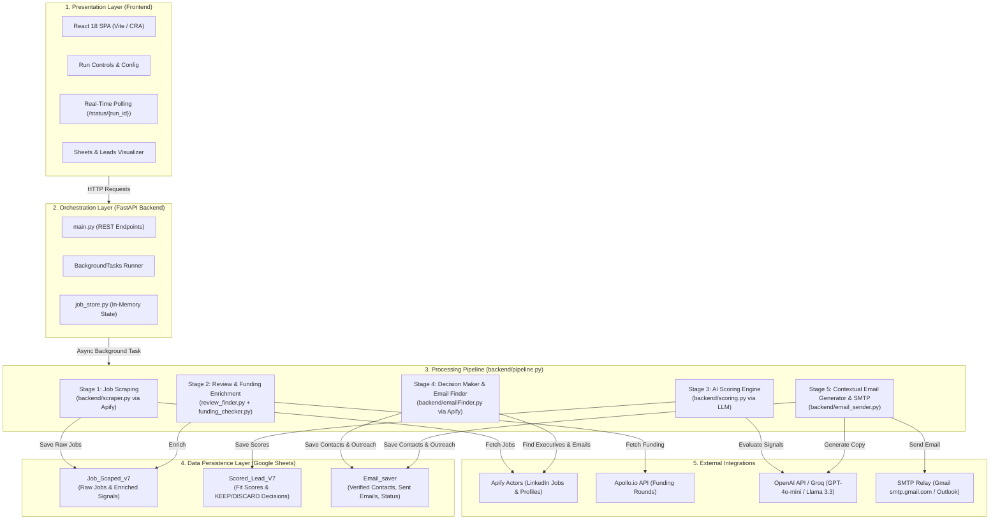

# Automated B2B Lead Generation & AI Outreach Platform
## Complete System Architecture, Workflow Specification & POC Guide

---

## 1. Executive Summary & Objective

The **Lead Generation & Automated Outreach Platform** is an end-to-end autonomous pipeline designed to discover, qualify, enrich, and contact high-value B2B prospects. 

Instead of generic cold mass-emailing, the platform identifies **companies with verified buying triggers** (e.g., active hiring bottlenecks, recent capital rounds, team burnout signals), extracts verified decision-maker emails via LinkedIn & Apify, uses an LLM to generate hyper-personalized 1-on-1 sales copy referencing those exact triggers, and dispatches the emails with rate-limiting via SMTP (Gmail / Outlook).

### Key Business Metrics Achieved
* **Zero Manual Copy-Pasting**: From initial LinkedIn job search to email dispatch, the entire pipeline executes automatically.
* **Hyper-Personalization**: Emails cite the target company's open roles, funding rounds, and operational scaling challenges rather than generic sales templates.
* **Built-in Deliverability & Safety**: Configurable test overrides redirect outgoing messages to a sandbox test inbox (`niloyvetesting54@gmail.com`) during evaluation to eliminate risk to production prospect relations.
* **Dual Persistence**: Real-time memory state for frontend UI monitoring + persistent Google Sheets for data auditing (`Job_Scaped_v7`, `Scored_Lead_V7`, `Email_saver`).

---

## 2. System Architecture & Component Diagram



---

## 3. End-to-End Workflow Stages

### Stage 1: LinkedIn Job Scraping & Size Filtering
* **Module**: [backend/scraper.py](file:///c:/Users/sandipansarkar/Documents/lead_gen_v01/backend/scraper.py)
* **Trigger**: Triggered via `POST /run-pipeline` or `POST /run-full`.
* **Execution**:
  1. Queries the Apify LinkedIn Jobs Scraper actor using user-defined criteria (e.g., keyword: `"Customer Support Specialist"`, location: `"Europe"` or `"United States"`, experience: `"entry-level"`, `"associate"`).
  2. Applies firmographic filters: keeps only companies with **50 to 1,000 employees** (sweet spot for high outsourcing willingness without enterprise bureaucracy).
  3. Calculates **Hiring Repeatability**: Analyzes how many times the company has reposted the same job family (a key metric for chronic hiring friction).

### Stage 2: Signal Enrichment (Funding & Employee Sentiment)
* **Modules**: [backend/review_finder.py](file:///c:/Users/sandipansarkar/Documents/lead_gen_v01/backend/review_finder.py), [backend/funding_checker.py](file:///c:/Users/sandipansarkar/Documents/lead_gen_v01/backend/funding_checker.py)
* **Execution**:
  1. **Apollo.io API**: Queries the company domain to extract `latest_funding_stage` (e.g., Seed, Series A, Series B), `latest_funding_round_date`, and `total_funding`.
  2. **Glassdoor Reviews**: Gathers employee sentiment snippets to detect operational stress indicators (e.g., *"understaffed"*, *"burnout"*, *"scaling pressure"*, *"backlog"*).
  3. All raw jobs + enriched signals are committed to Google Sheet: **`Job_Scaped_v7`**.

### Stage 3: Multi-Dimensional AI Scoring Engine
* **Module**: [backend/scoring.py](file:///c:/Users/sandipansarkar/Documents/lead_gen_v01/backend/scoring.py)
* **Evaluation Logic**:
  * **Exclusion Check**: Immediately rejects staffing agencies, consulting brokerages, and freelance marketplaces.
  * **Dimension 1 (Execution Signal: 0-3)**: Scores operational/support urgency (operational roles score highest; C-suite individual postings score 0).
  * **Dimension 2 (Hiring Intent: 0-3)**: Rule-based score based on hiring repeatability (3+ reposts = score 3).
  * **Dimension 3 (Company Fit: 0-2)**: Evaluates whether company is a tech/SaaS firm with 50–300 employees and Series A/B funding.
  * **Dimension 4 (Remote Readiness: 0-2)**: Bonus for remote/hybrid positions.
  * **Dimension 5 (Buying Trigger: 0-3)**: Evaluates fresh funding (< 12 months) combined with scaling workload pressure.
* **Output**:
  * Total Score (0 - 13).
  * **Decision**: **`KEEP`** (Score ≥ threshold and high fit) or **`DISCARD`**.
  * **Reason**: A concise synthesized rationale of why this company is ripe for outreach.
  * Rows written to Google Sheet: **`Scored_Lead_V7`** (KEEP rows highlighted green).

### Stage 4: Automated Decision-Maker & Email Discovery
* **Modules**: [backend/pipeline.py](file:///c:/Users/sandipansarkar/Documents/lead_gen_v01/backend/pipeline.py#L354-L440), [backend/emailFinder.py](file:///c:/Users/sandipansarkar/Documents/lead_gen_v01/backend/emailFinder.py)
* **Execution**:
  1. As soon as a lead is scored as **`KEEP`**, the pipeline intercepts the company's verified LinkedIn URL (`companyUrl`).
  2. **Deduplication Check**: Checks `Email_saver` to see if the company was already processed in a previous run. If so, skips it to preserve Apify credits.
  3. **Decision-Maker Lookup**: Calls Apify actor `Vb6LZkh4EqRlR0Ka9` targeting specific leadership titles:
     * *CEO, COO, Founder, VP Operations, Director of Operations, Chief People Officer, Head of Talent Acquisition*.
  4. **Email Resolution**: Calls Apify actor `bfH8Ermocz8oYKQVO` on the decision maker's LinkedIn profile to extract verified business/personal email addresses.

### Stage 5: Context-Aware LLM Email Personalization
* **Module**: [backend/email_sender.py](file:///c:/Users/sandipansarkar/Documents/lead_gen_v01/backend/email_sender.py#L140-L248)
* **Execution**:
  1. The pipeline cross-references `Job_Scaped_v7` and `Scored_Lead_V7` to assemble complete context:
     * Prospect Name & Title (e.g. *Kseniia Kutyreva, Managing Director*)
     * Company Name & Sector (e.g. *Finom, FinTech*)
     * Financial Trigger (e.g. *Recent funding round*)
     * Hiring Need (e.g. *Customer Care Specialists*)
     * Scoring Rationale (e.g. *Scaling operational headcount post-funding*)
     * Our Value Proposition (Outsourcing/offshoring, flexible hourly rates, no recruitment lock-in, zero overhead for appraisals/resignations).
  2. The LLM (`gpt-4o-mini` with `llama-3.3-70b` fallback) generates a high-converting, 80-word peer-to-peer cold email with a strict JSON schema.

### Stage 6: SMTP Transmission & Safety Routing
* **Module**: [backend/email_sender.py](file:///c:/Users/sandipansarkar/Documents/lead_gen_v01/backend/email_sender.py#L250-L335)
* **Execution**:
  1. Connects to `smtp.gmail.com:587` with TLS authentication.
  2. **Safety Routing**: Checks `TEST_EMAIL_OVERRIDE` in `.env`:
     * If `TEST_EMAIL_OVERRIDE=niloyvetesting54@gmail.com`: All outgoing messages are routed to this test inbox.
     * When set to `""` in production: Dispatches directly to the real decision-maker's email.
  3. **Pacing Delay**: Enforces automated sleep delays (5–10s during tests, 35–75s in batch runs) to keep sender IP reputation pristine.

### Stage 7: Persistence & Status Audit
* **Module**: [backend/sheets_helper.py](file:///c:/Users/sandipansarkar/Documents/lead_gen_v01/backend/sheets_helper.py)
* Appends the finalized record into Google Sheet: **`Email_saver`**:
  * Real prospect email preserved in `email` column.
  * Full subject & body saved in `emailBody`.
  * Status recorded as `SENT (to niloyvetesting54@gmail.com)` or `SENT`.
  * Timestamp recorded in `sentAt`.

---

## 4. Google Sheets Data Schema Reference

### Sheet 1: `Job_Scaped_v7` (Raw Sourced Jobs & Enrichments)
| Column | Type | Description |
| :--- | :--- | :--- |
| `jobId` | String | Unique LinkedIn job identifier |
| `jobTitle` | String | Scraped job title |
| `jobUrl` | String | LinkedIn job posting URL |
| `jobDescription` | Text | Full job requirements & responsibilities |
| `companyName` | String | Organization name |
| `location` | String | Job/Company location |
| `publishedDate` | String | Posting date |
| `contractType` | String | Full-time / Contract / Part-time |
| `experienceLevel`| String | Entry / Associate / Mid-Senior |
| `workType` | String | Remote / Hybrid / On-site |
| `sector` | String | Industry classification |
| `companyEmployeeCount` | Integer | Headcount |
| `companyUrl` | String | LinkedIn company profile URL |
| `companyWebsite` | String | Direct corporate website |
| `Repeatability` | Integer | Repost frequency count |
| `Reviews` | Text | Glassdoor employee sentiment summary |
| `latest_funding_stage` | String | Seed / Series A / Series B / etc. |
| `latest_funding` | String | Capital raised in most recent round |
| `latest_funding_round_date`| String | Date of last round |
| `total_funding` | String | Aggregate capital raised |

### Sheet 2: `Scored_Lead_V7` (AI Qualification Rationale)
| Column | Type | Description |
| :--- | :--- | :--- |
| `companyName` | String | Target company (Key link to other sheets) |
| `jobTitle` | String | Evaluated role |
| `Execution Signal` | Integer (0-3)| Operational role priority |
| `Hiring Intent` | Integer (0-3)| Repost & urgency score |
| `Company Fit` | Integer (0-2)| Headcount & tech-fit score |
| `Remote Readiness` | Integer (0-2)| Remote adoption score |
| `Buying Trigger` | Integer (0-3)| Fresh funding + scaling pressure score |
| `total_score` | Integer (0-13)| Aggregate composite score |
| `decision` | String | **`KEEP`** or **`DISCARD`** |
| `priority` | String | `HIGH`, `MEDIUM`, `LOW` |
| `reason` | Text | AI rationale synthesizing the buying trigger |

### Sheet 3: `Email_saver` (Outreach & Contact Registry)
| Column | Type | Description |
| :--- | :--- | :--- |
| `companyName` | String | Prospect company |
| `personName` | String | Full name of executive / decision maker |
| `email` | String | Real verified prospect email address |
| `designation` | String | Executive title (e.g. Managing Director, VP Ops) |
| `linkedinUrl` | String | Executive LinkedIn profile URL |
| `addedAt` | Timestamp | Lead discovery timestamp |
| `emailBody` | Text | Full AI-generated email subject and body sent |
| `outreachStatus` | String | `PENDING`, `SENT (to niloyvetesting54@gmail.com)`, `SENT`, or `FAILED` |
| `sentAt` | Timestamp | SMTP dispatch timestamp |

---

## 5. Environment Configuration (.env)

| Variable | Required? | Example / Format | Purpose |
| :--- | :---: | :--- | :--- |
| `APIFY_KEY_1` / `APIFY_KEY_2` | Yes | `apify_api_...` | Sourcing LinkedIn jobs & decision makers |
| `APOLLO_API_KEY` | Yes | `Encihp8...` | Sourcing funding stages and round dates |
| `OPENAI_API_KEY` | Yes | `sk-proj-...` | LLM lead scoring & email copy generation |
| `GROQ_API_KEY` | Optional | `gsk_...` | High-speed LLM fallback (`llama-3.3-70b`) |
| `GOOGLE_CREDENTIALS_JSON` | Yes | JSON string | Google Service Account for Sheet Read/Write |
| `SMTP_HOST` | Yes | `smtp.gmail.com` | SMTP host (`smtp.office365.com` for Outlook) |
| `SMTP_PORT` | Yes | `587` | Standard STARTTLS port |
| `SMTP_USER` | Yes | `annoymous0409@gmail.com` | Sending email address |
| `SMTP_PASSWORD` | Yes | `16-char app password` | Google App Password (not standard password) |
| `TEST_EMAIL_OVERRIDE` | **Yes (in test)**| `niloyvetesting54@gmail.com` | **Safety switch**: intercepts all emails to this address |

---

## 6. How to Run & Validate the POC

### Method 1: Automated End-to-End Run (Frontend UI)
1. Ensure both backend and frontend are running:
   ```powershell
   # Backend:
   uvicorn backend.main:app --reload
   # Frontend:
   npm run dev (or npm start)
   ```
2. Open the frontend in your browser.
3. On the **Home Page**, choose your target criteria (e.g. Role: `"Customer Support"`, Location: `"Europe"`, Items: `10`).
4. Click **Launch Full Pipeline**.
5. The pipeline will automatically scrape jobs → enrich reviews/funding → score leads → identify `KEEP` companies → scrape decision makers → generate tailored emails → send them to `niloyvetesting54@gmail.com` → record status in `Email_saver`.

### Method 2: Standalone CLI Test Runner
To test just the email generation and dispatch on the latest lead stored in your sheet:
```powershell
.venv\Scripts\python.exe backend/email_sender.py
```
* In `email_sender.py`, `test_stored_lead()` automatically fetches the last row in `Email_saver`, calls the LLM with company context, and delivers the email to `niloyvetesting54@gmail.com`.

---

## 7. Production Rollout Guide (Going from Test to Live)

When the testing phase is complete and you want to start emailing **real prospects**:

1. **Disable Safety Test Redirect**:
   In `.env`, clear the `TEST_EMAIL_OVERRIDE` variable:
   ```env
   TEST_EMAIL_OVERRIDE=
   ```
   *When this variable is empty, the pipeline dispatches directly to the decision-maker's real scraped email.*

2. **Increase Pacing Delays**:
   In [backend/pipeline.py](file:///c:/Users/sandipansarkar/Documents/lead_gen_v01/backend/pipeline.py#L432), adjust `time.sleep()` from `5` seconds to `45–60` seconds between emails to maintain strict sender domain reputation.

3. **Switching to Outlook (When Ready)**:
   In `.env`, change:
   ```env
   SMTP_HOST=smtp.office365.com
   SMTP_PORT=587
   SMTP_USER=your_name@yourcompany.com
   SMTP_PASSWORD=your_office365_password
   ```
   *Standard SMTP requires zero Python code changes to switch from Gmail to Microsoft 365.*
